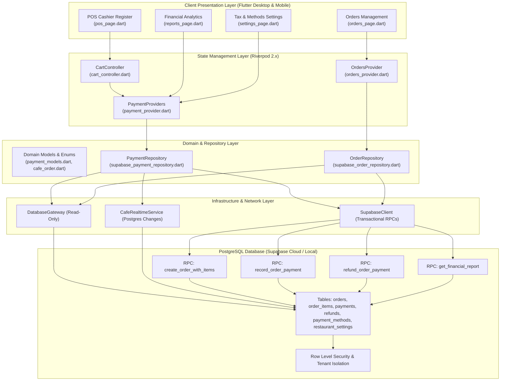
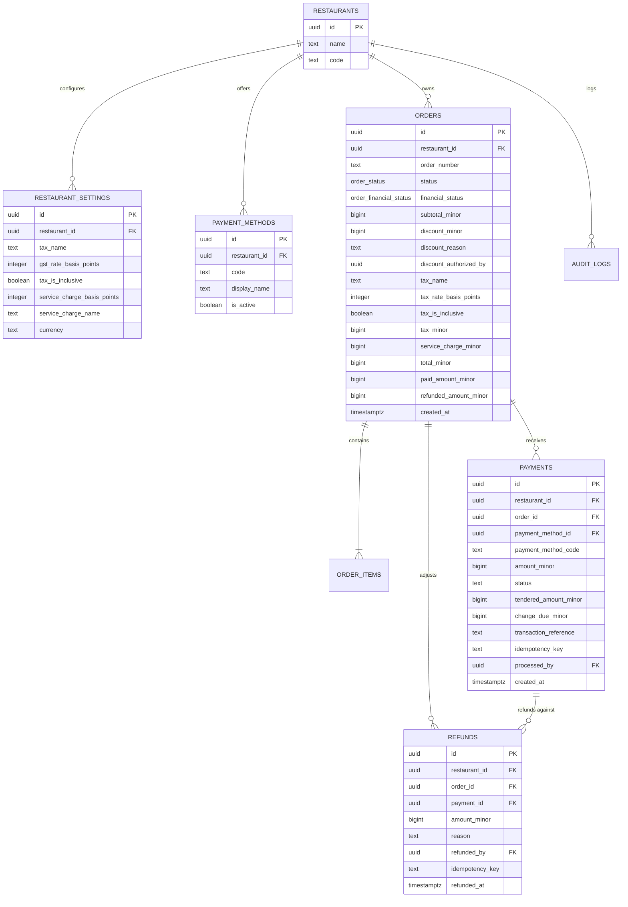

# CafeFlow — Billing Architecture Specification

## 1. Architectural Overview

CafeFlow implements an end-to-end, multi-tenant billing and settlement architecture designed for restaurant and cafe point-of-sale environments. The system guarantees financial integrity, strict tenant isolation via PostgreSQL Row Level Security (RLS), ACID-compliant transactional settlement, safe fixed-precision monetary math, and realtime multi-station synchronization across Windows Cashier/Owner terminals, Android Staff devices, and Kitchen Display Systems (KDS).

---

## 2. Core Billing Principles

### 2.1 Fixed-Precision Monetary Representation
Floating-point numbers (`double` or `float`) are strictly forbidden in CafeFlow financial calculations to prevent IEEE 754 rounding drift, off-by-one errors, and ledger discrepancies.
- All monetary values in PostgreSQL and Flutter are stored and calculated as 64-bit integer minor units (paise in India, cents in US/EU):
  $$\text{Amount}_{\text{minor}} = \text{Amount}_{\text{major}} \times 100$$
- Database schema uses `BIGINT` for all `*_minor` columns.
- Display formatting formats minor units with explicit two-decimal precision:
  $$\text{Formatted} = \text{₹} + \frac{\text{minor}}{100.0}$$
- Text input parsing uses string integer decomposition:
  $$\text{minor} = (\text{integral} \times 100) + \text{fractional}$$

### 2.2 Server-Validated Financial Calculations
Client-submitted line totals, taxes, and grand totals are treated as untrusted user input.
- Flutter `CartController` performs live client-side calculations solely for instant cashier feedback and user interface reactivity.
- When an order is submitted, `create_order_with_items` fetches authentic menu item prices directly from `public.menu_items`, verifies that each item belongs to the caller's restaurant tenant, reads authentic tax rate and inclusive flags from `public.restaurant_settings`, and calculates:
  - Line totals: $\text{quantity} \times \text{price\_minor}$
  - Order subtotal: $\sum \text{line\_total}$
  - Taxable subtotal: $\max(0, \text{subtotal} - \text{discount\_minor})$
  - Service charge: $(\text{taxable} \times \text{service\_charge\_bps} + 5000) / 10000$
  - Exclusive tax (if configured): $(\text{taxable} \times \text{tax\_rate\_bps} + 5000) / 10000$
  - Inclusive tax (if configured): $(\text{taxable} \times \text{tax\_rate\_bps}) / (10000 + \text{tax\_rate\_bps})$
  - Grand total: $\text{taxable} + \text{tax}_{\text{exclusive}} + \text{service\_charge}$
- This design prevents malicious price tampering, unauthorized discounts, or stale cached prices.

### 2.3 Decoupling Kitchen Status from Financial Status
To reflect physical restaurant workflows accurately, operational food preparation is cleanly decoupled from financial billing settlement:
1. **Operational Order Status (`order_status` enum)**:
   - `NEW`: Order ticket created at register or table.
   - `PREPARING`: Kitchen staff has accepted and begun preparing tickets.
   - `READY`: Kitchen pass has finished; ready for plating or counter pickup.
   - `COMPLETED`: Food delivered to guest and table vacated.
   - `CANCELLED`: Order aborted.
2. **Financial Status (`order_financial_status` enum)**:
   - `UNPAID`: Order tab open; balance due equals grand total.
   - `PARTIALLY_PAID`: Deposit or split payment received; remaining balance $> 0$.
   - `PAID`: Full settlement received; outstanding balance $= 0$.
   - `PARTIALLY_REFUNDED`: Authorized refund returned part of paid funds; food order intact.
   - `REFUNDED`: Total paid funds returned to customer.
   - `PAYMENT_FAILED`: Terminal decline or rejected transaction.

This decoupling allows flexible operational models:
- **Fast-Casual / Counter Service**: Pay-now flow (order creation and payment recording execute atomically within the same cashier interaction).
- **Full Dine-In Service**: Pay-later flow (kitchen prepares and serves order while financial status remains `UNPAID`; cashier settles bill at end of dining experience).

---

## 3. Database Schema & Relational Model

---

## 4. Multi-Tenant Isolation & Role-Based Security

### 4.1 Row Level Security (RLS) Policies
Every table in the financial pipeline enforces RLS:
- **`public.payments`**:
  - `SELECT`: Restricted to authenticated members of the restaurant tenant (`tenant_has_active_membership(restaurant_id)`). Kitchen staff is barred by application routing from accessing financial ledger tables.
  - `INSERT / UPDATE`: Must pass through audited `SECURITY DEFINER` stored procedure `record_order_payment`, preventing arbitrary direct table inserts.
- **`public.refunds`**:
  - `SELECT`: Restricted to `OWNER` and `ADMIN` tenant members. Cashiers and kitchen staff cannot read refund audit logs.
  - `INSERT`: Strictly restricted to `OWNER` and `ADMIN` via `refund_order_payment` RPC.
- **`public.payment_methods`**:
  - `SELECT`: Readable by all authenticated restaurant staff (`tenant_has_active_membership(restaurant_id)`).
  - `UPDATE`: Modifiable only by `OWNER` and `ADMIN` via `update_payment_method_status` RPC.

### 4.2 Idempotency & Concurrency Control
Payment and refund operations accept an optional `p_idempotency_key` (UUID v4 or deterministic client transaction hash):
- Before processing a payment, the RPC queries `public.payments` for existing records with the same `(restaurant_id, idempotency_key)`.
- If found, the existing payment result is replayed immediately without incrementing totals or creating duplicate cash entries.
- Concurrent updates to the same order lock the target row via `SELECT ... FROM public.orders WHERE id = p_order_id FOR UPDATE`, eliminating race conditions when multiple cashiers attempt to settle the same bill simultaneously.

---

## 5. Audit Logging & Compliance

All financial actions automatically write immutable entries to `public.audit_logs`:
- **`PAYMENT_RECORDED`**: Records `order_id`, `payment_id`, `amount_minor`, `method_code`, `processed_by`, and change tendered.
- **`PAYMENT_REFUNDED`**: Records `order_id`, `payment_id`, `refund_id`, `refund_amount_minor`, `reason`, and `authorized_by`.
- **`TAX_SETTINGS_UPDATED`**: Records changes to GST rates, inclusive tax mode, or service surcharge basis points.
- **`PAYMENT_METHOD_TOGGLED`**: Records status adjustments to Cash, UPI, or Card acceptance.

