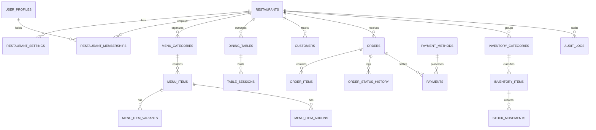

# CAFEFLOW — DATABASE SCHEMA SPECIFICATION

**Version:** 1.0.0  
**Target Engine:** Supabase PostgreSQL 17  
**Schema Scope:** Multi-Tenant Restaurant Operations, POS, Inventory, and Auditing  
**Primary Key Convention:** UUIDv4 (`gen_random_uuid()`)  
**Currency Convention:** Fixed-precision integer minor units (`BIGINT` paise / cents, e.g. 24000 = ₹240.00)

---

## 1. Architectural Overview

CafeFlow utilizes a multi-tenant relational schema where all operational data is partitioned by `restaurant_id`. Historical financial integrity is preserved through immutable line-item snapshotting: modifying or archiving menu products never mutates existing completed or in-flight orders.

Soft deletion (`deleted_at TIMESTAMPTZ`) is enforced across primary business entities, preventing accidental relational cascades while maintaining data hygiene.

---

## 2. Enumerated Types (ENUMs)

- `app_role`: `'OWNER'`, `'ADMIN'`, `'CASHIER'`, `'KITCHEN'`, `'STAFF'`
- `order_status`: `'NEW'`, `'PREPARING'`, `'READY'`, `'COMPLETED'`, `'CANCELLED'`
- `payment_status`: `'PENDING'`, `'COMPLETED'`, `'FAILED'`, `'REFUNDED'`
- `table_status`: `'AVAILABLE'`, `'OCCUPIED'`, `'RESERVED'`
- `stock_movement_type`: `'PURCHASE'`, `'USAGE'`, `'WASTAGE'`, `'ADJUSTMENT'`

---

## 3. Entity Definitions

### 1. `restaurants` (Tenants)
| Column | Type | Constraints | Description |
|---|---|---|---|
| `id` | UUID | PRIMARY KEY, DEFAULT gen_random_uuid() | Tenant identifier |
| `name` | TEXT | NOT NULL | Registered cafe brand name |
| `slug` | TEXT | NOT NULL, UNIQUE | Public URL slug |
| `address` | TEXT | NULLABLE | Physical location address |
| `phone` | TEXT | NULLABLE | Primary contact phone |
| `email` | TEXT | NULLABLE | Billing & management email |
| `is_active` | BOOLEAN | NOT NULL, DEFAULT true | Tenant operational status |
| `created_at` | TIMESTAMPTZ| NOT NULL, DEFAULT now() | Creation timestamp |
| `updated_at` | TIMESTAMPTZ| NOT NULL, DEFAULT now() | Last update timestamp |
| `deleted_at` | TIMESTAMPTZ| NULLABLE | Soft delete timestamp |

### 2. `restaurant_settings`
| Column | Type | Constraints | Description |
|---|---|---|---|
| `id` | UUID | PRIMARY KEY, DEFAULT gen_random_uuid() | Setting identifier |
| `restaurant_id` | UUID | NOT NULL, REFERENCES restaurants(id) ON DELETE CASCADE, UNIQUE | Tenant reference |
| `currency` | TEXT | NOT NULL, DEFAULT 'INR' | ISO currency code |
| `gst_rate_basis_points` | INT | NOT NULL, DEFAULT 500, CHECK (>= 0) | Tax basis points (500 = 5.00%) |
| `receipt_prefix` | TEXT | NOT NULL, DEFAULT 'ORD-' | Order number format prefix |
| `kot_printer_name` | TEXT | NULLABLE | Kitchen ticket printer name |
| `auto_accept_orders` | BOOLEAN | NOT NULL, DEFAULT false | Whether POS orders skip manual accept |
| `created_at` | TIMESTAMPTZ| NOT NULL, DEFAULT now() | Creation timestamp |
| `updated_at` | TIMESTAMPTZ| NOT NULL, DEFAULT now() | Last update timestamp |

### 3. `user_profiles`
| Column | Type | Constraints | Description |
|---|---|---|---|
| `id` | UUID | PRIMARY KEY, REFERENCES auth.users(id) ON DELETE CASCADE | Matches Supabase Auth UID |
| `full_name` | TEXT | NOT NULL | Staff member display name |
| `phone` | TEXT | NULLABLE | Staff contact number |
| `is_active` | BOOLEAN | NOT NULL, DEFAULT true | Account authorization status |
| `created_at` | TIMESTAMPTZ| NOT NULL, DEFAULT now() | Creation timestamp |
| `updated_at` | TIMESTAMPTZ| NOT NULL, DEFAULT now() | Last update timestamp |
| `deleted_at` | TIMESTAMPTZ| NULLABLE | Soft delete timestamp |

### 4. `restaurant_memberships`
| Column | Type | Constraints | Description |
|---|---|---|---|
| `id` | UUID | PRIMARY KEY, DEFAULT gen_random_uuid() | Membership record ID |
| `restaurant_id` | UUID | NOT NULL, REFERENCES restaurants(id) ON DELETE CASCADE | Associated tenant |
| `user_id` | UUID | NOT NULL, REFERENCES user_profiles(id) ON DELETE CASCADE | Associated user profile |
| `role` | app_role | NOT NULL | Assigned role in this cafe |
| `is_active` | BOOLEAN | NOT NULL, DEFAULT true | Active employment status |
| `created_at` | TIMESTAMPTZ| NOT NULL, DEFAULT now() | Membership creation |
| `updated_at` | TIMESTAMPTZ| NOT NULL, DEFAULT now() | Last role modification |
| `deleted_at` | TIMESTAMPTZ| NULLABLE | Termination / archive timestamp |
| *Constraint* | UNIQUE | (restaurant_id, user_id) | Prevent duplicate membership records |

### 5. `menu_categories`
| Column | Type | Constraints | Description |
|---|---|---|---|
| `id` | UUID | PRIMARY KEY, DEFAULT gen_random_uuid() | Category identifier |
| `restaurant_id` | UUID | NOT NULL, REFERENCES restaurants(id) ON DELETE CASCADE | Tenant isolation |
| `name` | TEXT | NOT NULL | e.g. Coffee, Bakery, Mains |
| `display_order`| INT | NOT NULL, DEFAULT 0 | POS and web sorting index |
| `is_active` | BOOLEAN | NOT NULL, DEFAULT true | Category visibility |
| `created_at` | TIMESTAMPTZ| NOT NULL, DEFAULT now() | Creation timestamp |
| `updated_at` | TIMESTAMPTZ| NOT NULL, DEFAULT now() | Update timestamp |
| `deleted_at` | TIMESTAMPTZ| NULLABLE | Soft deletion |

### 6. `menu_items`
| Column | Type | Constraints | Description |
|---|---|---|---|
| `id` | UUID | PRIMARY KEY, DEFAULT gen_random_uuid() | Item identifier |
| `restaurant_id` | UUID | NOT NULL, REFERENCES restaurants(id) ON DELETE CASCADE | Tenant isolation |
| `category_id` | UUID | NOT NULL, REFERENCES menu_categories(id) ON DELETE RESTRICT | Category FK |
| `name` | TEXT | NOT NULL | Product name |
| `description` | TEXT | DEFAULT '' | Culinary description |
| `price_minor` | BIGINT | NOT NULL, CHECK (>= 0) | Base price in minor currency units |
| `image_url` | TEXT | DEFAULT '' | Supabase Storage image reference |
| `is_available` | BOOLEAN | NOT NULL, DEFAULT true | Live 86 / availability toggle |
| `is_featured` | BOOLEAN | NOT NULL, DEFAULT false | Highlighted on public web hero |
| `is_archived` | BOOLEAN | NOT NULL, DEFAULT false | Hidden from active catalog |
| `created_at` | TIMESTAMPTZ| NOT NULL, DEFAULT now() | Creation timestamp |
| `updated_at` | TIMESTAMPTZ| NOT NULL, DEFAULT now() | Update timestamp |
| `deleted_at` | TIMESTAMPTZ| NULLABLE | Soft deletion |

### 7. `menu_item_variants`
| Column | Type | Constraints | Description |
|---|---|---|---|
| `id` | UUID | PRIMARY KEY, DEFAULT gen_random_uuid() | Variant identifier |
| `menu_item_id` | UUID | NOT NULL, REFERENCES menu_items(id) ON DELETE CASCADE | Parent item |
| `name` | TEXT | NOT NULL | e.g. Regular, Large, Single Origin |
| `price_adjustment_minor` | BIGINT | NOT NULL, DEFAULT 0 | Price delta in minor units |
| `is_available` | BOOLEAN | NOT NULL, DEFAULT true | Availability toggle |
| `created_at` | TIMESTAMPTZ| NOT NULL, DEFAULT now() | Creation timestamp |
| `updated_at` | TIMESTAMPTZ| NOT NULL, DEFAULT now() | Update timestamp |
| `deleted_at` | TIMESTAMPTZ| NULLABLE | Soft deletion |

### 8. `menu_item_addons`
| Column | Type | Constraints | Description |
|---|---|---|---|
| `id` | UUID | PRIMARY KEY, DEFAULT gen_random_uuid() | Addon identifier |
| `menu_item_id` | UUID | NOT NULL, REFERENCES menu_items(id) ON DELETE CASCADE | Parent item |
| `name` | TEXT | NOT NULL | e.g. Oat Milk, Extra Shot, Vanilla |
| `price_minor` | BIGINT | NOT NULL, DEFAULT 0, CHECK (>= 0) | Extra cost in minor units |
| `is_available` | BOOLEAN | NOT NULL, DEFAULT true | Availability toggle |
| `created_at` | TIMESTAMPTZ| NOT NULL, DEFAULT now() | Creation timestamp |
| `updated_at` | TIMESTAMPTZ| NOT NULL, DEFAULT now() | Update timestamp |
| `deleted_at` | TIMESTAMPTZ| NULLABLE | Soft deletion |

### 9. `dining_tables`
| Column | Type | Constraints | Description |
|---|---|---|---|
| `id` | UUID | PRIMARY KEY, DEFAULT gen_random_uuid() | Table identifier |
| `restaurant_id` | UUID | NOT NULL, REFERENCES restaurants(id) ON DELETE CASCADE | Tenant isolation |
| `table_number` | TEXT | NOT NULL | Identifier (e.g. Table 01) |
| `capacity` | INT | NOT NULL, CHECK (> 0) | Maximum seated guest capacity |
| `status` | table_status| NOT NULL, DEFAULT 'AVAILABLE' | AVAILABLE, OCCUPIED, RESERVED |
| `created_at` | TIMESTAMPTZ| NOT NULL, DEFAULT now() | Creation timestamp |
| `updated_at` | TIMESTAMPTZ| NOT NULL, DEFAULT now() | Update timestamp |
| `deleted_at` | TIMESTAMPTZ| NULLABLE | Soft deletion |
| *Constraint* | UNIQUE | (restaurant_id, table_number) | Unique table numbers per cafe |

### 10. `table_sessions`
| Column | Type | Constraints | Description |
|---|---|---|---|
| `id` | UUID | PRIMARY KEY, DEFAULT gen_random_uuid() | Seating session identifier |
| `table_id` | UUID | NOT NULL, REFERENCES dining_tables(id) ON DELETE CASCADE | Table FK |
| `guest_count` | INT | NOT NULL, DEFAULT 1, CHECK (> 0) | Number of guests seated |
| `opened_at` | TIMESTAMPTZ| NOT NULL, DEFAULT now() | Seating timestamp |
| `closed_at` | TIMESTAMPTZ| NULLABLE | Departure timestamp |
| `created_at` | TIMESTAMPTZ| NOT NULL, DEFAULT now() | Creation timestamp |

### 11. `customers`
| Column | Type | Constraints | Description |
|---|---|---|---|
| `id` | UUID | PRIMARY KEY, DEFAULT gen_random_uuid() | Customer identifier |
| `restaurant_id` | UUID | NOT NULL, REFERENCES restaurants(id) ON DELETE CASCADE | Tenant isolation |
| `name` | TEXT | NOT NULL | Guest name |
| `phone` | TEXT | NULLABLE | Phone number for loyalty |
| `email` | TEXT | NULLABLE | Email for e-receipts |
| `loyalty_tier` | TEXT | NOT NULL, DEFAULT 'GUEST' | GOLD, SILVER, GUEST |
| `total_spend_minor` | BIGINT | NOT NULL, DEFAULT 0, CHECK (>= 0) | Cumulative lifetime spend |
| `visits_count` | INT | NOT NULL, DEFAULT 0, CHECK (>= 0) | Visit tally |
| `favorite_item`| TEXT | DEFAULT '' | Most ordered item |
| `last_visited_at` | TIMESTAMPTZ| NULLABLE | Recent visit timestamp |
| `created_at` | TIMESTAMPTZ| NOT NULL, DEFAULT now() | Creation timestamp |
| `updated_at` | TIMESTAMPTZ| NOT NULL, DEFAULT now() | Update timestamp |
| `deleted_at` | TIMESTAMPTZ| NULLABLE | Soft deletion |

### 12. `orders`
| Column | Type | Constraints | Description |
|---|---|---|---|
| `id` | UUID | PRIMARY KEY, DEFAULT gen_random_uuid() | Order identifier |
| `restaurant_id` | UUID | NOT NULL, REFERENCES restaurants(id) ON DELETE CASCADE | Tenant isolation |
| `order_number` | TEXT | NOT NULL | Formatted sequence (e.g. ORD-104) |
| `table_id` | UUID | REFERENCES dining_tables(id) ON DELETE SET NULL | Optional table FK |
| `table_name` | TEXT | DEFAULT 'Takeaway' | Frozen table or takeaway name |
| `customer_id` | UUID | REFERENCES customers(id) ON DELETE SET NULL | Optional customer FK |
| `status` | order_status| NOT NULL, DEFAULT 'NEW' | Lifecycle status |
| `subtotal_minor`| BIGINT | NOT NULL, CHECK (>= 0) | Sum of item totals |
| `discount_minor`| BIGINT | NOT NULL, DEFAULT 0, CHECK (>= 0)| Applied coupon or discount |
| `tax_minor` | BIGINT | NOT NULL, DEFAULT 0, CHECK (>= 0)| Calculated GST tax |
| `total_minor` | BIGINT | NOT NULL, CHECK (>= 0) | Final payable total |
| `special_instructions`| TEXT | DEFAULT '' | Dietary / allergen notes |
| `created_by` | UUID | REFERENCES user_profiles(id) ON DELETE SET NULL | Staff member who fired order |
| `created_at` | TIMESTAMPTZ| NOT NULL, DEFAULT now() | Placement timestamp |
| `updated_at` | TIMESTAMPTZ| NOT NULL, DEFAULT now() | Update timestamp |
| `deleted_at` | TIMESTAMPTZ| NULLABLE | Soft cancellation |

### 13. `order_items` (Historical Line Snapshotting)
| Column | Type | Constraints | Description |
|---|---|---|---|
| `id` | UUID | PRIMARY KEY, DEFAULT gen_random_uuid() | Item line identifier |
| `order_id` | UUID | NOT NULL, REFERENCES orders(id) ON DELETE CASCADE | Parent order FK |
| `menu_item_id` | UUID | REFERENCES menu_items(id) ON DELETE SET NULL | Origin menu item FK |
| `item_name` | TEXT | NOT NULL | **Snapshot:** Product name at purchase time |
| `unit_price_minor`| BIGINT | NOT NULL, CHECK (>= 0) | **Snapshot:** Base price at purchase time |
| `quantity` | INT | NOT NULL, CHECK (> 0) | Ordered count |
| `total_price_minor`| BIGINT| NOT NULL, CHECK (>= 0) | Line total in minor units |
| `selected_variant`| TEXT | NULLABLE | Selected variant name |
| `selected_addons` | TEXT[] | NULLABLE | Selected addon names |
| `notes` | TEXT | DEFAULT '' | Line-level cooking request |
| `created_at` | TIMESTAMPTZ| NOT NULL, DEFAULT now() | Timestamp |

### 14. `order_status_history`
| Column | Type | Constraints | Description |
|---|---|---|---|
| `id` | UUID | PRIMARY KEY, DEFAULT gen_random_uuid() | History event ID |
| `order_id` | UUID | NOT NULL, REFERENCES orders(id) ON DELETE CASCADE | Order FK |
| `previous_status`| order_status| NULLABLE | Status before transition |
| `new_status` | order_status| NOT NULL | Status after transition |
| `changed_by` | UUID | REFERENCES user_profiles(id) ON DELETE SET NULL | Responsible user |
| `changed_at` | TIMESTAMPTZ| NOT NULL, DEFAULT now() | Transition timestamp |
| `notes` | TEXT | DEFAULT '' | Reason / station notes |

### 15. `payment_methods`
| Column | Type | Constraints | Description |
|---|---|---|---|
| `id` | UUID | PRIMARY KEY, DEFAULT gen_random_uuid() | Payment method ID |
| `restaurant_id` | UUID | NOT NULL, REFERENCES restaurants(id) ON DELETE CASCADE | Tenant isolation |
| `code` | TEXT | NOT NULL | CASH, UPI, CARD |
| `display_name` | TEXT | NOT NULL | Customer-facing label |
| `is_active` | BOOLEAN | NOT NULL, DEFAULT true | Enabled status |
| `created_at` | TIMESTAMPTZ| NOT NULL, DEFAULT now() | Creation timestamp |
| *Constraint* | UNIQUE | (restaurant_id, code) | Unique code per cafe |

### 16. `payments`
| Column | Type | Constraints | Description |
|---|---|---|---|
| `id` | UUID | PRIMARY KEY, DEFAULT gen_random_uuid() | Transaction ID |
| `order_id` | UUID | NOT NULL, REFERENCES orders(id) ON DELETE RESTRICT | Settled order |
| `payment_method_id`| UUID | REFERENCES payment_methods(id) ON DELETE RESTRICT | Method FK |
| `payment_method_code`| TEXT | NOT NULL | Method code (CASH, UPI, CARD) |
| `amount_minor` | BIGINT | NOT NULL, CHECK (> 0) | Amount paid in minor units |
| `status` | payment_status| NOT NULL, DEFAULT 'PENDING' | Transaction state |
| `transaction_reference`| TEXT| NULLABLE | UPI UTR or card auth code |
| `processed_at` | TIMESTAMPTZ| NULLABLE | Settlement timestamp |
| `created_at` | TIMESTAMPTZ| NOT NULL, DEFAULT now() | Creation timestamp |

### 17. `inventory_categories`
| Column | Type | Constraints | Description |
|---|---|---|---|
| `id` | UUID | PRIMARY KEY, DEFAULT gen_random_uuid() | Category ID |
| `restaurant_id` | UUID | NOT NULL, REFERENCES restaurants(id) ON DELETE CASCADE | Tenant isolation |
| `name` | TEXT | NOT NULL | e.g. Coffee Beans, Dairy, Packaging |
| `created_at` | TIMESTAMPTZ| NOT NULL, DEFAULT now() | Creation timestamp |
| `deleted_at` | TIMESTAMPTZ| NULLABLE | Soft deletion |

### 18. `inventory_items`
| Column | Type | Constraints | Description |
|---|---|---|---|
| `id` | UUID | PRIMARY KEY, DEFAULT gen_random_uuid() | Ingredient ID |
| `restaurant_id` | UUID | NOT NULL, REFERENCES restaurants(id) ON DELETE CASCADE | Tenant isolation |
| `category_id` | UUID | REFERENCES inventory_categories(id) ON DELETE SET NULL| Category FK |
| `name` | TEXT | NOT NULL | Ingredient name |
| `unit` | TEXT | NOT NULL | kg, liters, units, packs |
| `current_stock`| NUMERIC(12, 3)| NOT NULL, DEFAULT 0 | Live stock quantity |
| `reorder_level`| NUMERIC(12, 3)| NOT NULL, DEFAULT 0 | Low-stock alert threshold |
| `cost_per_unit_minor`| BIGINT | NOT NULL, DEFAULT 0 | Purchase cost in minor units |
| `created_at` | TIMESTAMPTZ| NOT NULL, DEFAULT now() | Creation timestamp |
| `updated_at` | TIMESTAMPTZ| NOT NULL, DEFAULT now() | Update timestamp |
| `deleted_at` | TIMESTAMPTZ| NULLABLE | Soft deletion |

### 19. `stock_movements`
| Column | Type | Constraints | Description |
|---|---|---|---|
| `id` | UUID | PRIMARY KEY, DEFAULT gen_random_uuid() | Movement log ID |
| `inventory_item_id`| UUID | NOT NULL, REFERENCES inventory_items(id) ON DELETE CASCADE | Ingredient FK |
| `movement_type`| stock_movement_type| NOT NULL | PURCHASE, USAGE, WASTAGE, ADJUSTMENT |
| `quantity_change`| NUMERIC(12, 3)| NOT NULL | Signed change (+ or -) |
| `previous_stock`| NUMERIC(12, 3)| NOT NULL | Snapshot before adjustment |
| `new_stock` | NUMERIC(12, 3)| NOT NULL | Snapshot after adjustment |
| `reason` | TEXT | DEFAULT '' | Audit memo |
| `performed_by` | UUID | REFERENCES user_profiles(id) ON DELETE SET NULL | Staff member FK |
| `created_at` | TIMESTAMPTZ| NOT NULL, DEFAULT now() | Timestamp |

### 20. `audit_logs`
| Column | Type | Constraints | Description |
|---|---|---|---|
| `id` | UUID | PRIMARY KEY, DEFAULT gen_random_uuid() | Log event ID |
| `restaurant_id` | UUID | NOT NULL, REFERENCES restaurants(id) ON DELETE CASCADE | Tenant isolation |
| `user_id` | UUID | REFERENCES user_profiles(id) ON DELETE SET NULL | Responsible user |
| `action` | TEXT | NOT NULL | INSERT, UPDATE, DELETE, VOID, REFUND |
| `entity_type` | TEXT | NOT NULL | Target table name |
| `entity_id` | UUID | NULLABLE | Primary key of altered row |
| `old_data` | JSONB | NULLABLE | Previous record state |
| `new_data` | JSONB | NULLABLE | New record state |
| `ip_address` | TEXT | NULLABLE | Client IP for security audits |
| `created_at` | TIMESTAMPTZ| NOT NULL, DEFAULT now() | Immutable timestamp |

