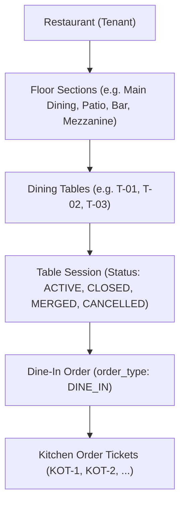

# CafeFlow Floor Management Architecture

## 1. Executive Summary

Phase 08 introduces enterprise-grade dining room and floor management to CafeFlow, establishing a unified multi-platform system across Web, Windows, and Android. The architecture bridges the physical cafe floor with the digital order lifecycle, synchronizing table occupancy, seating capacities, table sessions, and kitchen fulfillment in real time.

---

## 2. Floor Layout & Domain Hierarchy



### Key Entities:
1. **`floor_sections`**: Configurable dining areas within a restaurant.
   - Fields: `id`, `restaurant_id`, `name`, `code`, `description`, `sort_order`, `is_active`.
   - Allows fine-grained operational categorization (e.g. "Main Dining", "Outdoor Patio", "Espresso Bar", "Private Lounge").
2. **`dining_tables`**: Physical tables located within sections.
   - Fields: `id`, `restaurant_id`, `section_id`, `table_number`, `capacity`, `status`, `active_session_id`.
   - Table capacities determine guest allocation limits.
   - Foreign key `section_id` links tables to their respective floor sections.
3. **`table_sessions`**: The lifecycle record of a seated party.
   - Fields: `id`, `restaurant_id`, `table_id`, `guest_count`, `status`, `opened_at`, `closed_at`, `current_order_id`, `opened_by`, `closed_by`, `notes`.
   - Engine-enforced partial unique index guarantees that no table can host more than one `ACTIVE` session simultaneously.

---

## 3. Operational Table Statuses

The dining table lifecycle supports six explicit operational statuses:

| Status Code | Label | Color / Indicator | Description | Permitted Next Actions |
|---|---|---|---|---|
| `AVAILABLE` | Available | Green Pill / Check Icon | Table is vacant, sanitized, and ready for guests | `Seat guests` -> Opens session (`OCCUPIED`) |
| `OCCUPIED` | Occupied | Blue Pill / People Icon | Guests seated, active dining session in progress | Add items, Transfer, Merge, Request Bill |
| `RESERVED` | Reserved | Purple Pill / Bookmark Icon | Table held for anticipated party | Seat arriving guests, Cancel reservation |
| `BILL_REQUESTED` | Bill Requested | Amber Pill / Receipt Icon | Guests requested bill; checkout/payment pending | Settle payment, Print bill receipt |
| `CLEANING` | Cleaning | Cyan Pill / Sparkle Icon | Guests departed; table being bussed and sanitized | Mark clean (`AVAILABLE`) |
| `OUT_OF_SERVICE` | Out of Service | Grey Pill / Prohibited Icon | Maintenance, broken furniture, or closed section | Return to service (`AVAILABLE`) |

---

## 4. Concurrency & Tenant Isolation

1. **Partial Unique Index**:
   ```sql
   CREATE UNIQUE INDEX idx_unique_active_table_session
       ON table_sessions(table_id)
       WHERE status = 'ACTIVE';
   ```
   This prevents race conditions where two cashiers or waitstaff attempt to open a session on the same table simultaneously. The second write fails deterministically at the database engine level.

2. **Row-Level Security (RLS)**:
   All queries and mutations on `floor_sections`, `dining_tables`, `table_sessions`, and `table_transfers_audit` are gated by `restaurant_id` checks against the authenticated user's active membership. Cross-tenant access is strictly denied.

3. **Realtime Broadcast**:
   All table status updates, session opens, and session closures broadcast immediately through Supabase Realtime via `CafeRealtimeService.watchDiningTables` and `watchTableSessions`, ensuring instant floor UI updates across all cashier and staff terminals.

