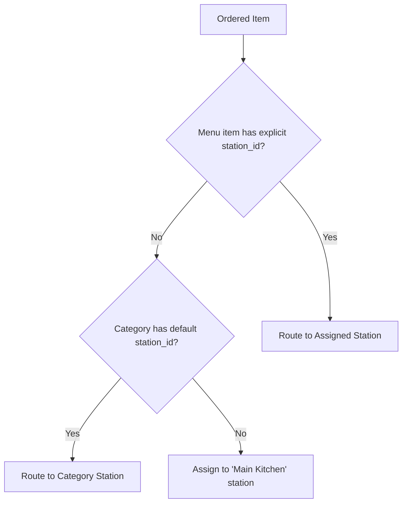

# CafeFlow Kitchen Station Routing

## 1. Overview

In busy cafe and restaurant environments, orders are prepared across specialized stations. An espresso drink must route to the Barista Station, a grilled sandwich to the Hot Kitchen, a croissant to the Bakery Station, and salads to Cold Prep.

CafeFlow provides flexible, configurable kitchen station routing with safe fallback mechanisms.

---

## 2. Configurable Kitchen Stations

Stations are defined in `kitchen_stations`:

| Station Code | Station Name | Responsibilities | Target Devices |
|---|---|---|---|
| `MAIN` | Main Kitchen | General food preparation & default fallback | Main Kitchen Display / Line Printer |
| `HOT` | Hot Kitchen & Grills | Cooked foods, paninis, eggs, warm entrees | Hot Line Display / Grill Printer |
| `BAR` | Beverage Bar & Espresso | Specialty espresso, pour-overs, teas, shakes | Barista KDS / Bar Thermal Printer |
| `BAKERY` | Bakery & Pastry | Fresh croissants, pastries, baked desserts | Pastry Station Display / Label Printer |
| `COLD` | Cold Prep & Salads | Fresh salads, yogurt bowls, cold sandwiches | Cold Station Display |

---

## 3. Station Assignment Hierarchy

When an order is created, items are routed based on the following hierarchy:

1. **Item-Level Assignment**: If the menu item specifies a target `kitchen_station_id`, that station takes precedence.
2. **Category-Level Fallback**: If unspecified, the parent category's default station is used (e.g. all items in "Coffee" default to "Beverage Bar").
3. **Safe Default Fallback**: If neither is specified, the system routes the item to the restaurant's default "Main Kitchen" station. No item is ever dropped or lost.

---

## 4. Kitchen Display Filtering

The `KitchenPage` display provides interactive station filtering:
- **"All Stations" View**: For expeditors, head chefs, or small venues operating a single unified kitchen display.
- **Dedicated Station Views**: Tapping a station filter chip (e.g. `Beverage Bar`) filters active KOT tickets to display only items and tickets destined for that production area.
- Station headers and tickets show real-time ticket counts and elapsed timers.

