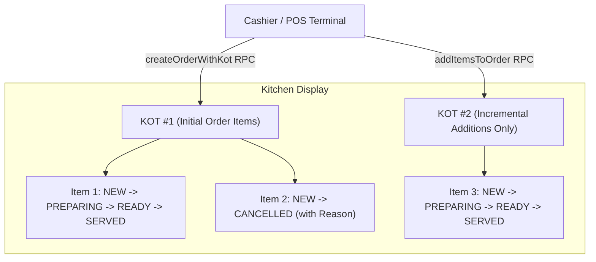

# CafeFlow Kitchen Order Ticket (KOT) Workflow

## 1. Overview

In restaurant hospitality, a **Kitchen Order Ticket (KOT)** is the operational directive delivered to kitchen stations to prepare food and beverages. CafeFlow's KOT subsystem guarantees:
1. **Station Routing**: Items are routed to their designated production stations (Hot Kitchen, Beverage Bar, Bakery, or Main Kitchen).
2. **Incremental Firing**: Adding items to an existing dining table order generates a new incremental ticket ($N+1$) without duplicate preparation of previously fired items.
3. **Item-Level Status Tracking**: Each item within a ticket maintains an independent fulfillment state (`NEW`, `ACCEPTED`, `PREPARING`, `READY`, `SERVED`, `CANCELLED`).
4. **Role Security Separation**: Kitchen displays strictly hide financial data (prices, tax, discounts, paid amounts, payment settlement) to uphold tenant security and role separation.

---

## 2. KOT Ticket & Item Lifecycle

---

## 3. Sequential Numbering & Idempotency

- **Sequential KOT Numbering**: KOT tickets receive sequential ticket numbers formatted as `KOT-XXXX` (or `KOT-<orderNumber>-<seq>`), generated via database sequence per restaurant tenant.
- **Idempotency Protection**: In offline-first or poor network environments, duplicate creation requests carry `client_tx_id`. Server-side verification returns the existing ticket on retry without duplicate printing or double fulfillment.

---

## 4. Incremental Order Additions

When guests at an active table session order additional items (e.g. dessert or second round of drinks):
1. Cashier adds items to cart in POS and selects the active table.
2. The POS detects the open order (`active_session_id`) and displays:
   `Active order: CF-1004. New items will be added as an incremental KOT ticket.`
3. Upon checkout, the POS calls `add_items_to_table_order` RPC:
   - Appends items to `order_items` linked to the active order.
   - Recalculates subtotal, tax, and order total minor units.
   - Computes `next_seq = coalesce(max(sequence_number), 0) + 1`.
   - Creates a new `kitchen_order_tickets` record for `next_seq`.
   - Inserts **only** the newly added items into `kot_items`.
   - **Crucial Rule**: Existing, previously served items are never re-sent to the kitchen.

---

## 5. Item Fulfillment & Cancellation Invariants

1. **Item Status Transitions**:
   - `NEW` -> `ACCEPTED` -> `PREPARING` -> `READY` -> `SERVED`
2. **Cancellation with Reason**:
   - Items can be cancelled at any time prior to serving.
   - Cancellation requires an explicit reason (e.g. "86'd / out of stock", "guest changed mind", "entry mistake").
   - Recorded with `cancelled_at` timestamp and `cancel_reason`.
3. **Elapsed Preparation Timers**:
   - `KotTicketCard` calculates real-time ticket age (`DateTime.now() - createdAt`).
   - Tickets aged 15 minutes or longer display a prominent amber/red warning pill (`warning_amber_rounded`) with elapsed duration to prioritize delayed tables.

