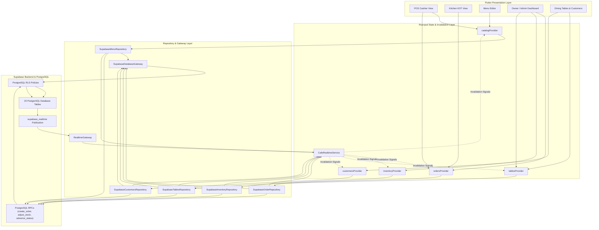

# CAFEFLOW — LIVE DATA ARCHITECTURE

**Document Version:** 1.0.0  
**Phase:** 05  
**Date:** November 15, 2026  
**Status:** IMPLEMENTED & VERIFIED  

---

## 1. Architectural Overview

CafeFlow operates on a unidirectional, typed, repository-driven data flow that strictly separates presentation, state management, database access, and transport layers. UI widgets never communicate directly with Supabase or emit SQL queries.



---

## 2. Core Architecture Tenets

1. **No Widget Direct Queries**:
   - Widgets consume immutable domain models via Riverpod providers (`ref.watch(ordersProvider)`, `ref.watch(catalogProvider)`).
   - All mutations dispatch through typed repository methods (`repo.createOrder(...)`, `repo.createMenuItem(...)`, `repo.adjustStock(...)`).
2. **Server-Side Financial & Business Logic**:
   - Client applications never calculate financial totals or tax values for database insertion.
   - All order calculations occur inside PostgreSQL RPCs (`create_order_with_items`), which lookup live active menu item prices directly from `public.menu_items`.
3. **Multi-Tenant Isolation**:
   - Every live query and mutation is bound to `auth.activeMembership?.restaurantId`.
   - PostgreSQL RLS enforces that users can only select, insert, or update data for restaurants where they hold an active membership.
4. **Idempotency Protection**:
   - Order submissions generate a client-side UUID `idempotencyKey` passed to `create_order_with_items`.
   - If a network retry occurs, PostgreSQL detects the unique constraint on `public.orders(restaurant_id, idempotency_key)` and returns the existing order result rather than creating a duplicate charge.

---

## 3. Dual-Mode Strategy (Live vs Demo)

CafeFlow supports seamless operation in both live Supabase environments and offline/unconfigured environments without codebase divergence:

| Aspect | Live Supabase Mode | Demo / Unconfigured Fallback |
| :--- | :--- | :--- |
| **Detection** | `BackendStatus.initialized` AND `auth.activeMembership?.restaurantId != null` | Missing credentials, backend down, or no active membership |
| **Data Source** | Live PostgreSQL via `Supabase*Repository` | In-memory `DemoOperations` & `Demo*Controller` |
| **Indicator Badge** | Green "LIVE CLOUD CONNECTED" badge with restaurant ID | Amber "DEMO MODE" notice banner |
| **Realtime** | Active WebSocket subscription to `supabase_realtime` | Local synchronous state updates |
| **Storage** | Supabase Storage (`menu-images` bucket) | Memory data URLs / placeholder assets |

---

## 4. State Caching & Realtime Invalidation Pattern

Instead of complex client-side cache manipulation, Riverpod providers subscribe to `CafeRealtimeService` invalidation streams. When a remote mutation occurs:

```dart
final ordersProvider = FutureProvider<List<CafeOrder>>((ref) async {
  final backend = ref.watch(backendProvider);
  final repo = ref.watch(orderRepositoryProvider);
  final auth = ref.watch(authControllerProvider);
  final restaurantId = auth.activeMembership?.restaurantId;

  if (backend.status == BackendStatus.initialized &&
      repo is SupabaseOrderRepository &&
      restaurantId != null) {
    // 1. Subscribe to scoped real-time invalidations
    final sub = repo.watchInvalidations(restaurantId: restaurantId).listen((_) {
      ref.invalidateSelf();
    });
    ref.onDispose(sub.cancel);

    // 2. Fetch fresh live data
    return await repo.fetchOrders(restaurantId: restaurantId);
  }

  // 3. Fallback to demo orders if unconfigured
  return ref.watch(demoOrdersProvider);
});
```

Benefits:
- **Zero Memory Leaks**: Subscriptions are automatically cancelled when the widget unmounts (`ref.onDispose(sub.cancel)`).
- **Single Source of Truth**: State is always refreshed from PostgreSQL, guaranteeing accurate totals and server timestamps.
- **Zero Race Conditions**: Subscriptions are scoped to the current restaurant ID and do not cross-pollinate tenant data.

