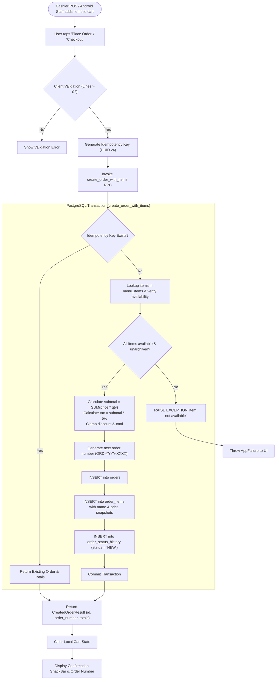

# CAFEFLOW — ORDER CREATION FLOW

**Document Version:** 1.0.0  
**Phase:** 05  
**Date:** November 15, 2026  
**Status:** IMPLEMENTED & VERIFIED  

---

## 1. End-to-End Order Creation Flow

CafeFlow implements an atomic order creation pipeline designed to eliminate partial failures, prevent client price tampering, enforce menu availability, and guarantee financial consistency.



---

## 2. Server-Side Price & Availability Validation

In standard client applications, a malicious or malfunctioning client could submit customized prices or subtotal values. CafeFlow eliminates this attack vector:
1. **Client Submission Payload**:
   The client submits **only** the `menu_item_id`, `quantity`, and optional item notes:
   ```json
   [
     {"menu_item_id": "7f8b9...", "quantity": 2, "notes": "Oat milk"},
     {"menu_item_id": "1c4d2...", "quantity": 1, "notes": "Extra hot"}
   ]
   ```
2. **Database Lookup**:
   The `create_order_with_items` function performs a parameterized join against `public.menu_items`:
   ```sql
   SELECT mi.id, mi.name, mi.price_minor, mi.is_available, mi.is_archived
   INTO v_item
   FROM public.menu_items mi
   WHERE mi.id = v_item_id
     AND mi.restaurant_id = p_restaurant_id;

   IF NOT FOUND OR v_item.is_archived OR NOT v_item.is_available THEN
       RAISE EXCEPTION 'Menu item % is unavailable or archived.', v_item_id;
   END IF;
   ```
3. **Snapshotting**:
   The name and unit price are snapshotted into `public.order_items`. If the cafe updates prices later, existing order records and past revenue analytics remain completely unaffected.

---

## 3. Financial Calculations

- **Subtotal Minor**:
  $$\text{subtotal\_minor} = \sum (\text{unit\_price\_minor} \times \text{quantity})$$
- **Discount Clamping**:
  $$\text{discount\_minor} = \min(\text{p\_discount\_minor}, \text{subtotal\_minor})$$
- **Tax Minor** (configured to 5%):
  $$\text{tax\_minor} = \left\lfloor \frac{(\text{subtotal\_minor} - \text{discount\_minor}) \times 5}{100} \right\rfloor$$
- **Total Minor**:
  $$\text{total\_minor} = (\text{subtotal\_minor} - \text{discount\_minor}) + \text{tax\_minor}$$

---

## 4. Idempotency & Network Retries

Network drops can cause a client to retry an order creation request. To prevent double-charging or duplicate kitchen tickets:
- The client generates a unique UUID `idempotencyKey`.
- `public.orders` enforces a unique constraint on `(restaurant_id, idempotency_key)`.
- If an order with that key already exists, `create_order_with_items` immediately queries the existing order and returns its totals without creating another ticket.

