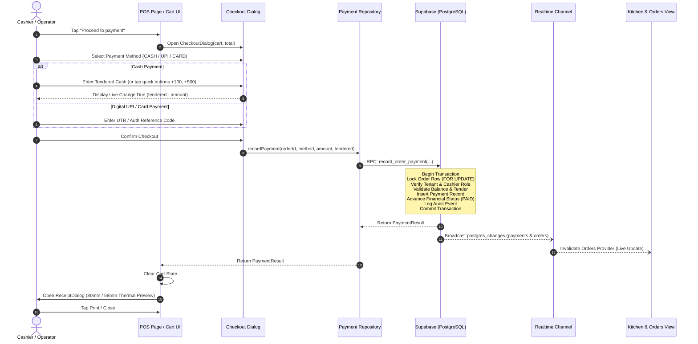

# CafeFlow — Payment Processing & Settlement Workflow

## 1. Overview

This document specifies the operational lifecycle, cashier user interfaces, transactional procedures, and realtime event propagation for processing payments in CafeFlow. The payment engine supports multiple payment methods (Cash, UPI Digital QR, Credit/Debit Card), partial/split payments, tender validation, instant change calculation, and thermal receipt dispatch.

---

## 2. Cashier Checkout Interaction Flow

---

## 3. Supported Payment Methods & Validation

### 3.1 Cash (`CASH`)
- **Tender Requirement**: Cashier must collect currency equal to or greater than the payment amount:
  $$\text{tendered\_amount\_minor} \ge \text{amount\_minor}$$
- **Change Due Formula**:
  $$\text{change\_due\_minor} = \text{tendered\_amount\_minor} - \text{amount\_minor}$$
- **Quick Denominations**: The UI provides quick-add pill buttons for high-velocity counter operations:
  - `Exact`: Sets tendered amount exactly equal to balance due.
  - `+₹100`: Increments tendered cash by ₹100.00 (10,000 paise).
  - `+₹500`: Increments tendered cash by ₹500.00 (50,000 paise).
- **Validation Guard**: If tendered amount is less than amount to pay, the submit button is disabled and an inline warning appears: *"Tendered amount must be at least the payment amount."*

### 3.2 UPI Digital QR (`UPI`)
- Supports instant Bharat Interface for Money / Unified Payments Interface transactions.
- **Reference Tracking**: Cashier enters or scans the 12-digit UTR (Unique Transaction Reference) or banking transaction ID.
- Stored in `transaction_reference` column for daily digital reconciliation against merchant bank statements.
- **Change Due**: Always `0`.

### 3.3 Credit / Debit Card (`CARD`)
- Supports point-of-sale terminal settlement (EDC/POS machine swipe/chip/tap).
- **Reference Tracking**: Cashier enters terminal Approval Code / Retrieval Reference Number (RRN).
- **PCI-DSS Compliance**: **No raw primary account numbers (PAN), CVV/CVC codes, or magnetic stripe data are ever stored or transmitted.** Only non-sensitive authorization reference codes are recorded.
- **Change Due**: Always `0`.

---

## 4. Partial & Split Payments

CafeFlow natively supports split and partial payments on a single order ticket:
1. When opening the settlement dialog from `OrdersPage`, the cashier can enter a custom partial amount less than the order's `outstanding_minor`.
2. The `record_order_payment` RPC validates:
   $$\text{amount\_minor} \le (\text{total\_minor} - \text{paid\_amount\_minor})$$
3. Upon insertion, `paid_amount_minor` increments:
   $$\text{paid\_amount\_minor}_{\text{new}} = \text{paid\_amount\_minor}_{\text{old}} + \text{amount\_minor}$$
4. If `paid_amount_minor < total_minor`, the order's `financial_status` transitions to `PARTIALLY_PAID`.
5. Subsequent payments can be settled using different payment methods (e.g., ₹200 via Cash, remaining ₹300 via UPI) until `outstanding_minor` reaches `0`, at which point `financial_status` becomes `PAID`.

---

## 5. Pay-Now vs Pay-Later Workflows

| Characteristic | Pay-Now (Fast-Casual / Counter) | Pay-Later (Dine-In Table Service) |
| :--- | :--- | :--- |
| **Trigger Screen** | `PosPage` (Bottom Cart Action) | `OrdersPage` (Order Ticket Action) |
| **Order Creation** | Created immediately prior to payment | Created when guest orders at table |
| **Initial Financial State** | Transitions immediately to `PAID` | Remains `UNPAID` during dining |
| **Kitchen Acceptance** | Order arrives in kitchen marked `PAID` | Order arrives in kitchen marked `UNPAID` |
| **Settlement Step** | Atomic checkout dialog at register | Settle button clicked after meal |
| **Receipt Timing** | Handed to customer at payment counter | Printed at table or payment desk |

---

## 6. Gateway Readiness & Extensibility

While current deployments operate in cash/UPI/card register recording mode, the architecture is designed to integrate third-party payment gateways (Razorpay, Stripe, Square, Pine Labs) without breaking changes:
- `PaymentRepository` defines abstract interfaces returning `PaymentResult`.
- Database table `payments` contains `transaction_reference`, `gateway_order_id`, and `idempotency_key` columns.
- Webhook endpoints can invoke `record_order_payment` directly using verified server-side credentials.

