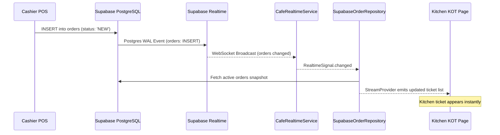

# CAFEFLOW — REALTIME ARCHITECTURE & EVENT FLOW

**Version:** 1.0.0  
**Transport:** Supabase Realtime (WebSocket Postgres Changes)  
**Coordination Service:** `lib/core/services/cafe_realtime_service.dart`

---

## 1. Architectural Philosophy

In CafeFlow, realtime updates power instant collaboration between the Cashier POS, Kitchen Display System (KDS), Waitstaff devices, and Manager Dashboards.

To guarantee memory safety and clean state management:
1. **No UI Channel Subscriptions:** Flutter UI widgets never subscribe directly to Supabase Realtime channels.
2. **Dedicated Service Layer:** Subscriptions are managed by `CafeRealtimeService` wrapping `RealtimeGateway`.
3. **Invalidation Signal Pattern:** Realtime events emit typed invalidation signals (`RealtimeSignal.changed`), prompting the corresponding repository to refetch an authorized snapshot.
4. **Resilient Reconnection:** When a network disconnect occurs and the WebSocket recovers, `RealtimeSignal.subscribed` automatically triggers a fresh data pull, ensuring no events are lost during dropped connections.



---

## 2. Monitored Operational Tables

| Table | Event Triggers | Consuming Workspaces | Operational Impact |
|---|---|---|---|
| `orders` | INSERT, UPDATE | Kitchen, Cashier, Owner, Staff | New KOT tickets appear; order status advances |
| `order_items` | INSERT, UPDATE | Kitchen, Cashier | Real-time additions or modifications to open orders |
| `order_status_history`| INSERT | Kitchen, Admin, POS | Audit trail for order lifecycle progression |
| `menu_items` | UPDATE, DELETE | Cashier POS, Customer Web, Waitstaff | Instant 86ing (out-of-stock toggle) and price updates |
| `dining_tables` | UPDATE | POS, Waitstaff, Hostess | Table occupancy chips change color (Available -> Occupied) |
| `inventory_items` | UPDATE | Admin, Kitchen | Stock level depletion alerts and reorder warnings |

---

## 3. Database Publication Configuration

In Migration 03 (`20261114000003_realtime_and_storage.sql`), the `supabase_realtime` publication is configured with `REPLICA IDENTITY FULL`:

```sql
-- Enables full row payloads on UPDATE/DELETE
ALTER TABLE orders REPLICA IDENTITY FULL;
ALTER TABLE order_items REPLICA IDENTITY FULL;
ALTER TABLE menu_items REPLICA IDENTITY FULL;
ALTER TABLE dining_tables REPLICA IDENTITY FULL;
ALTER TABLE inventory_items REPLICA IDENTITY FULL;

-- Registers tables with publication
ALTER PUBLICATION supabase_realtime ADD TABLE orders;
ALTER PUBLICATION supabase_realtime ADD TABLE order_items;
ALTER PUBLICATION supabase_realtime ADD TABLE menu_items;
ALTER PUBLICATION supabase_realtime ADD TABLE dining_tables;
ALTER PUBLICATION supabase_realtime ADD TABLE inventory_items;
```

---

## 4. Flutter Integration Pattern

`CafeRealtimeService` exposes streams that can be watched in Riverpod application controllers:

```dart
// lib/core/services/cafe_realtime_service.dart
final cafeRealtimeServiceProvider = Provider<CafeRealtimeService?>((ref) {
  final backend = ref.watch(backendProvider);
  if (backend.status != BackendStatus.initialized) return null;
  return CafeRealtimeService(ref.watch(realtimeGatewayProvider));
});
```

### Watching Invalidations in Repositories
Repositories expose invalidation streams that UI controllers consume without coupling to Supabase channel lifecycles:

```dart
// Example: Catalog auto-refresh on real-time menu modifications
ref.listen(menuRepositoryProvider?.watchInvalidations(), (_, __) {
  ref.invalidate(catalogProvider);
});
```

