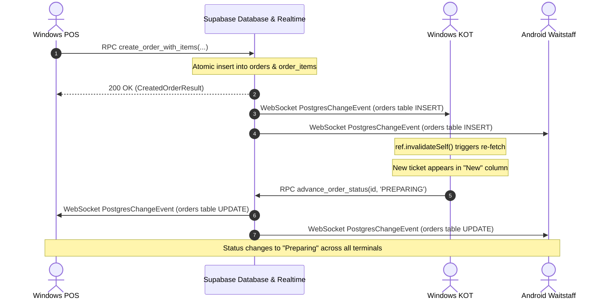

# CAFEFLOW — REALTIME IMPLEMENTATION

**Document Version:** 1.0.0  
**Phase:** 05  
**Date:** November 15, 2026  
**Status:** IMPLEMENTED & VERIFIED  

---

## 1. Realtime Overview

CafeFlow provides instant, cross-platform synchronization between Windows Desktop POS, Windows Kitchen KOT, and Android Staff terminals. Changes made at any terminal (such as placing an order, updating menu prices, or advancing a kitchen ticket) are immediately broadcast to all connected devices without manual polling.



---

## 2. Database Publications & Replica Identity

In `supabase/migrations/20261114000005_live_operations.sql`, the Supabase publication `supabase_realtime` is configured to publish changefeeds for all operational tables:

```sql
ALTER PUBLICATION supabase_realtime ADD TABLE public.menu_categories;
ALTER PUBLICATION supabase_realtime ADD TABLE public.customers;
ALTER PUBLICATION supabase_realtime ADD TABLE public.stock_movements;

ALTER TABLE public.menu_categories REPLICA IDENTITY FULL;
ALTER TABLE public.customers REPLICA IDENTITY FULL;
ALTER TABLE public.stock_movements REPLICA IDENTITY FULL;
```

Pre-existing publications from Phase 03 include:
- `public.orders` (`REPLICA IDENTITY FULL`)
- `public.order_items` (`REPLICA IDENTITY FULL`)
- `public.menu_items` (`REPLICA IDENTITY FULL`)
- `public.dining_tables` (`REPLICA IDENTITY FULL`)
- `public.inventory_items` (`REPLICA IDENTITY FULL`)

Using `REPLICA IDENTITY FULL` guarantees that UPDATE and DELETE payloads contain complete row state, ensuring filter predicates work reliably across old and new records.

---

## 3. Realtime Service Design (`CafeRealtimeService`)

The `CafeRealtimeService` acts as the single boundary between the Supabase WebSocket changefeed transport and the application layer.

### Scoped Tenant Filters
To prevent tenant cross-talk, change subscriptions are strictly parameterized with `restaurantId`:

```dart
PostgresChangeFilter? _restaurantFilter(String? restaurantId) {
  if (restaurantId == null || restaurantId.isEmpty) return null;
  return PostgresChangeFilter(
    type: PostgresChangeFilterType.eq,
    column: 'restaurant_id',
    value: restaurantId,
  );
}
```

### Provided Streams
| Method | Monitored Relation | Target Workspaces |
| :--- | :--- | :--- |
| `watchMenu({restaurantId})` | `menu_items` | POS, Waitstaff, Menu Management |
| `watchCategories({restaurantId})` | `menu_categories` | POS, Menu Management |
| `watchOrders({restaurantId})` | `orders` | Kitchen KOT, POS, Waitstaff, Dashboard |
| `watchDiningTables({restaurantId})` | `dining_tables` | Table Management, POS, Dashboard |
| `watchInventory({restaurantId})` | `inventory_items` | Inventory Management, Dashboard |
| `watchCustomers({restaurantId})` | `customers` | Customers Directory, POS |

---

## 4. Lifecycle & Resource Cleanup

To avoid memory leaks or orphaned WebSocket channels:
1. Every channel subscription is owned by a Riverpod `FutureProvider` or `StreamProvider`.
2. When the consumer widget is unmounted or navigating away, `ref.onDispose` is invoked.
3. The underlying `RealtimeGateway` calls `client.removeChannel(channel)`.

