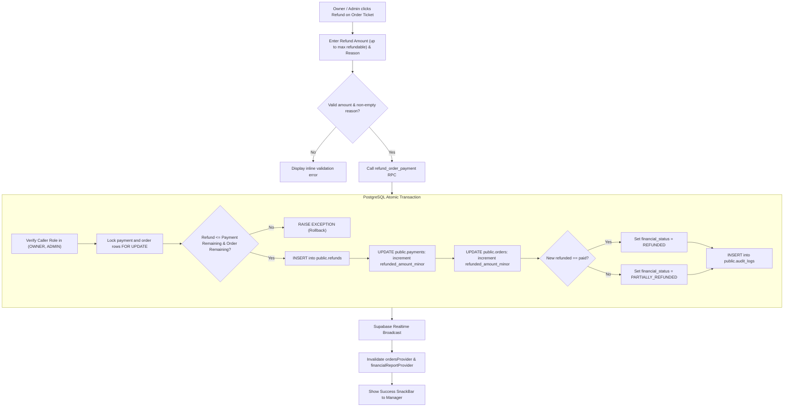

# CafeFlow — Refund, Void & Order Cancellation Policy

## 1. Overview & Policy Objectives

The CafeFlow financial engine treats refunds, voids, and order cancellations as sensitive, audited operations. All refund actions require elevated administrative privileges (`OWNER` or `ADMIN`), produce permanent audit trails in PostgreSQL, enforce strict monetary bounds, and update both payment transaction records and parent order financial states.

---

## 2. Role-Based Access Control (RBAC) Restrictions

| Action | CASHIER | KITCHEN | STAFF | ADMIN | OWNER |
| :--- | :---: | :---: | :---: | :---: | :---: |
| **Record Payment** | Yes | No | No | Yes | Yes |
| **View Past Receipts** | Yes | No | No | Yes | Yes |
| **Issue Partial Refund** | No | No | No | Yes | Yes |
| **Issue Full Refund** | No | No | No | Yes | Yes |
| **Cancel Unpaid Order** | Yes | No | No | Yes | Yes |
| **Cancel Paid Order** | No | No | No | Yes | Yes |

- **Security Enforcement**: Attempting to invoke the `refund_order_payment` RPC without an `OWNER` or `ADMIN` membership role in the target restaurant triggers an unhandled `P0001: Unauthorized: Only OWNER or ADMIN can authorize refunds.` exception and logs an unauthorized privilege escalation attempt.

---

## 3. Financial Bounds & Validation Constraints

A refund transaction must satisfy all of the following conditions simultaneously:
1. **Positive Refund Value**:
   $$\text{refund\_amount\_minor} > 0$$
2. **Payment Bound**: The refund amount cannot exceed the remaining net refundable funds of the specific target payment:
   $$\text{refund\_amount\_minor} \le (\text{payment.amount\_minor} - \text{payment.refunded\_amount\_minor})$$
3. **Order Bound**: The cumulative refunded amount across all payments cannot exceed the total amount paid on the order:
   $$\text{order.refunded\_amount\_minor} + \text{refund\_amount\_minor} \le \text{order.paid\_amount\_minor}$$
4. **Mandatory Audit Reason**: The `reason` parameter cannot be null or whitespace-only. It must state the justification (e.g., *"Customer returned damaged pastry"*, *"Billing discrepancy"*, *"Kitchen out of stock"*).

---

## 4. Refund Execution Lifecycle

---

## 5. Order Cancellation Rules

Order cancellations differ depending on whether funds have already been collected:
- **Unpaid Orders (`financial_status = UNPAID`)**:
  - Cashier or Admin can cancel the order directly.
  - Operational status transitions to `CANCELLED`.
  - No financial ledger mutations or refund rows are created because no funds were collected.
- **Paid Orders (`financial_status = PAID` or `PARTIALLY_PAID`)**:
  - The order cannot simply be deleted or cancelled without financial reconciliation.
  - An Admin/Owner must first execute a full refund against the recorded payment(s).
  - Once `refunded_amount_minor == paid_amount_minor`, the order's financial status reaches `REFUNDED` and its operational status can be marked `CANCELLED`.
  - This ensures that restaurant cash drawers and merchant bank statements balance precisely with POS records at day-end closing.

