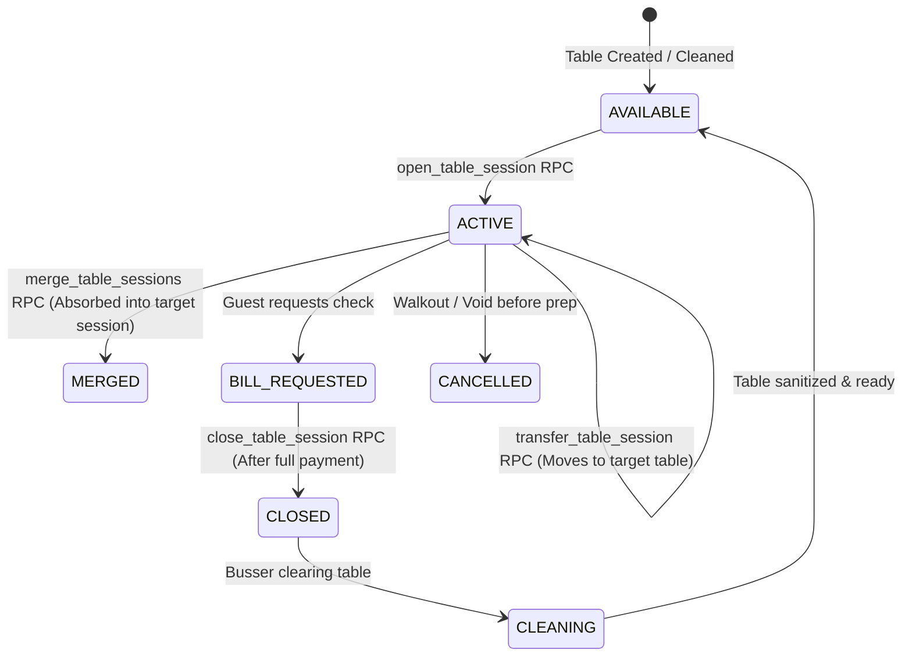

# CafeFlow Table Session Workflow & Invariants

## 1. Overview

In CafeFlow, a **Table Session** (`table_sessions`) represents the complete dining visit of a party at a specific table from arrival to departure. Unlike standalone quick-service orders, dine-in visits often span hours, involve multiple order additions (incremental KOTs), and require table transfers or merges.

---

## 2. Session State Lifecycle



---

## 3. Atomic Server-Side RPC Functions

### A. `open_table_session`
- **Purpose**: Creates an active session for a table and transitions table status to `OCCUPIED`.
- **Pre-Conditions**:
  - Calling user has `CASHIER`, `STAFF`, `ADMIN`, or `OWNER` role for the restaurant.
  - Target table must be in `AVAILABLE` or `RESERVED` status.
  - Table cannot have any existing `ACTIVE` session (enforced by engine unique index).
- **Execution**:
  - Inserts row into `table_sessions` with `status = 'ACTIVE'`, `opened_at = now()`, `opened_by = auth.uid()`.
  - Updates `dining_tables` setting `status = 'OCCUPIED'` and `active_session_id = <new_session_id>`.

### B. `close_table_session`
- **Purpose**: Closes a dining session once all orders are settled.
- **Safety Invariant**:
  - **Unsettled Order Guard**: Queries all orders linked to `table_session_id`. If any order has `financial_status` of `UNPAID` or `PARTIALLY_PAID`, the RPC aborts with an exception:
    `Cannot close table session with unsettled orders. Please settle all bills first.`
- **Execution**:
  - Updates `table_sessions` setting `status = 'CLOSED'`, `closed_at = now()`, `closed_by = auth.uid()`.
  - Clears `active_session_id` on `dining_tables`.
  - Sets table status to `CLEANING` (or `AVAILABLE`).

### C. `transfer_table_session`
- **Purpose**: Moves an active session and its associated orders from a source table to a target table (e.g. guests moving from indoors to patio).
- **Pre-Conditions**:
  - Source table must have an active session.
  - Target table must be currently `AVAILABLE`.
- **Execution**:
  - Atomically moves `table_id` reference on `table_sessions` to target table.
  - Updates source table status to `AVAILABLE` and clears its `active_session_id`.
  - Updates target table status to `OCCUPIED` and points `active_session_id` to the session.
  - Updates `table_name` on active orders and unfulfilled KOT tickets.
  - Logs transfer record in `table_transfers_audit` for security auditing:
    ```sql
    INSERT INTO table_transfers_audit(restaurant_id, transfer_type, source_table_id, target_table_id, session_id, order_id, transferred_by, notes)
    ...
    ```

### D. `merge_table_sessions`
- **Purpose**: Merges two parties into a single table session (e.g. adjacent tables joining together).
- **Execution**:
  - Re-links all orders from `source_session_id` to `target_session_id`.
  - Sets `source_session` status to `MERGED` with `closed_at = now()`.
  - Frees source table (`AVAILABLE` / `CLEANING`).
  - Logs merge record in `table_transfers_audit`.

---

## 4. Integrity Invariants Enforced

1. **No Concurrent Active Sessions**: Engine partial unique index `idx_unique_active_table_session` guarantees strictly zero duplicates.
2. **Financial Clearance Invariant**: No table session can close while outstanding balances exist.
3. **Audit Trail Invariant**: Every transfer and merge is permanently recorded with actor ID, timestamp, and optional notes in `table_transfers_audit`.

