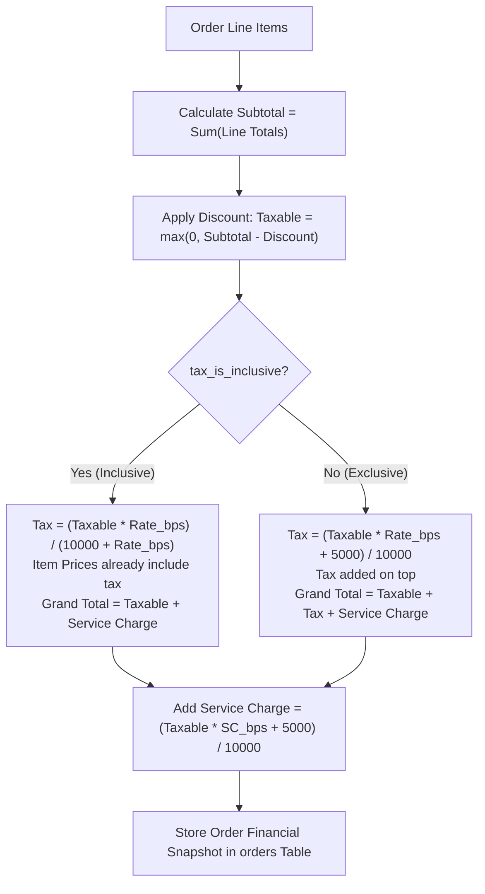

# CafeFlow — Tax, Surcharge & Discount Rules

## 1. Scope & Purpose

This document details the exact mathematical formulas, database constraints, business rules, and administrative controls governing taxes (GST/VAT), surcharges (service charges), and discounts in CafeFlow.

---

## 2. Tax Computation Models

Restaurants operate under different regulatory regimes regarding menu pricing:
1. **Tax Exclusive (Add-on Tax)**: Menu prices represent the net food cost; applicable tax is calculated and added on top at checkout.
2. **Tax Inclusive (Embedded Tax)**: Menu prices are all-inclusive; the tax component is embedded within the displayed item price and extracted for fiscal reporting.

CafeFlow provides native, configurable support for both models via `restaurant_settings`:
- `tax_name`: Display name (e.g., `"GST"`, `"VAT"`, `"Sales Tax"`).
- `gst_rate_basis_points`: Rate in basis points ($1\% = 100\text{ bps}$, e.g., $500\text{ bps} = 5.0\%$).
- `tax_is_inclusive`: Boolean flag determining the calculation path.

---

## 3. Mathematical Specifications

### 3.1 Order Subtotal & Taxable Base
Let $L$ be the set of order lines, each with unit price $p_i$ and quantity $q_i$:
$$\text{subtotal\_minor} = \sum_{i \in L} (p_i \times q_i)$$

Discounts reduce the taxable base before tax calculation:
$$\text{taxable\_minor} = \max(0, \text{subtotal\_minor} - \text{discount\_minor})$$

### 3.2 Exclusive Tax Formula
When `tax_is_inclusive = false`:
$$\text{tax\_minor} = \left\lfloor \frac{\text{taxable\_minor} \times \text{tax\_rate\_bps} + 5000}{10000} \right\rfloor$$
*(Note: $+5000$ achieves standard half-up integer rounding).*

Grand total:
$$\text{total\_minor} = \text{taxable\_minor} + \text{tax\_minor} + \text{service\_charge\_minor}$$

### 3.3 Inclusive Tax Formula
When `tax_is_inclusive = true`, the menu price already contains the tax obligation. The tax liability must be backward-extracted so the customer is not double-charged:
$$\text{tax\_minor} = \left\lfloor \frac{\text{taxable\_minor} \times \text{tax\_rate\_bps}}{10000 + \text{tax\_rate\_bps}} \right\rfloor$$

Net base food revenue:
$$\text{base\_food\_minor} = \text{taxable\_minor} - \text{tax\_minor}$$

Grand total:
$$\text{total\_minor} = \text{taxable\_minor} + \text{service\_charge\_minor}$$

### 3.4 Surcharge / Service Charge Formula
Optional service charges or packaging fees are calculated against the taxable base:
$$\text{service\_charge\_minor} = \left\lfloor \frac{\text{taxable\_minor} \times \text{service\_charge\_bps} + 5000}{10000} \right\rfloor$$

---

## 4. Numerical Verification Examples

| Parameter | Case A: Exclusive Tax (5% GST) | Case B: Inclusive Tax (5% GST) | Case C: Exclusive Tax + 2% Service Charge |
| :--- | :--- | :--- | :--- |
| **Line Item 1** | 2 × Cold Brew @ ₹200.00 = ₹400.00 | 1 × Combo Meal @ ₹210.00 = ₹210.00 | 2 × Cold Brew @ ₹200.00 = ₹400.00 |
| **Line Item 2** | 1 × Croissant @ ₹150.00 = ₹150.00 | — | 1 × Croissant @ ₹150.00 = ₹150.00 |
| **Subtotal** | ₹550.00 (55,000 paise) | ₹210.00 (21,000 paise) | ₹550.00 (55,000 paise) |
| **Discount** | ₹50.00 (5,000 paise) | ₹0.00 | ₹50.00 (5,000 paise) |
| **Taxable Base** | ₹500.00 (50,000 paise) | ₹210.00 (21,000 paise) | ₹500.00 (50,000 paise) |
| **Tax Rate** | 500 bps (5.0%) | 500 bps (5.0%) | 500 bps (5.0%) |
| **Tax Calculation** | $(50000 \times 500 + 5000) / 10000 = \mathbf{₹25.00}$ | $(21000 \times 500) / 10500 = \mathbf{₹10.00}$ | $(50000 \times 500 + 5000) / 10000 = \mathbf{₹25.00}$ |
| **Service Charge** | ₹0.00 (0 bps) | ₹0.00 (0 bps) | 200 bps (2.0%) = $\mathbf{₹10.00}$ |
| **Grand Total** | $\mathbf{₹525.00}$ (52,500 paise) | $\mathbf{₹210.00}$ (21,000 paise) | $\mathbf{₹535.00}$ (53,500 paise) |

---

## 5. Discount Validation & Authorization

Discounts are subject to strict business validation rules:
1. **Upper Bound**: $\text{discount\_minor} \le \text{subtotal\_minor}$. Discounts can never produce a negative payable total.
2. **Lower Bound**: $\text{discount\_minor} \ge 0$.
3. **Mandatory Audit Tracking**:
   - `discount_reason`: Text description required when applying discounts (e.g., *"Staff Courtesy"*, *"Loyalty Member"*, *"Promo Weekend"*).
   - `discount_authorized_by`: UUID of the authenticated cashier or manager applying the discount.
4. **Historical Immutability**: Order tax and discount rates are snapshotted on the `orders` record at checkout time. Future modifications to `restaurant_settings` will never retroactively mutate past closed order receipts.

